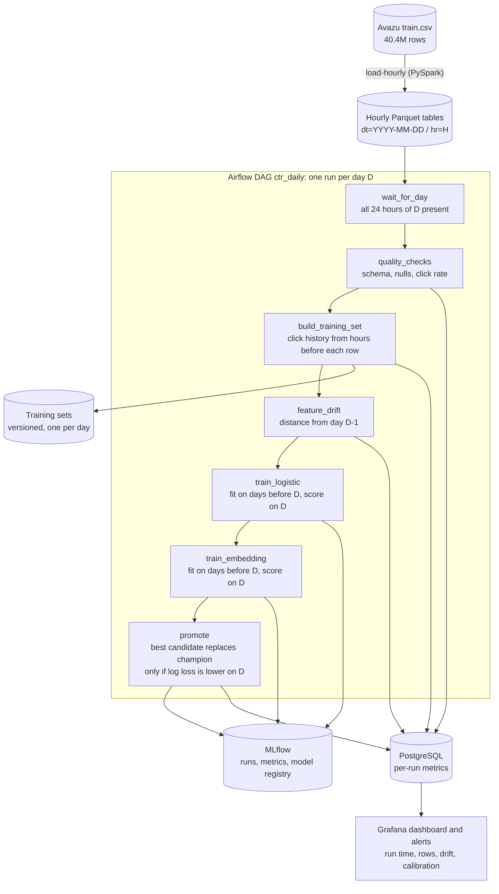

# CTR Training-Data and ML Pipeline

Turns 10 days of mobile ad logs into daily, leakage-free training sets, trains click-through-rate models on them, and promotes a new model only when it beats the current one. A prototype that runs end to end on a laptop.

- **Data:** [Avazu CTR](https://www.kaggle.com/competitions/avazu-ctr-prediction) `train.gz`, 40.4M ad impressions over 10 days (21 to 30 Oct 2014), each labelled clicked or not.
- **Stack:** Python 3.12, PySpark 4, Airflow 3, PyTorch, MLflow, PostgreSQL, Grafana, Docker Compose.
- **Models:** logistic regression and an embedding neural network on hashed categorical features, both retrained daily on earlier days and scored on the next day by AUC and log loss.

## How it works



Each Airflow task is one command (`python -m ctr_pipeline <step> --date D`), so every step also runs by hand without Airflow.

## Results

From one replay of 22 to 30 Oct on a laptop (Apple M4, 16 GB). Day D is scored on all of its rows; each model is fitted on a 15% uniform sample of the days before D.

| Day D | Training rows | Rows scored | Logistic AUC | Logistic log loss | Embedding AUC | Embedding log loss | Promoted |
|---|---|---|---|---|---|---|---|
| 23 Oct | 800,569 | 3,870,752 | 0.7248 | 0.4234 | 0.7264 | 0.4231 | embedding, v1 |
| 24 Oct | 1,381,182 | 3,335,302 | 0.7373 | 0.4078 | 0.7409 | 0.4062 | embedding, v2 |
| 25 Oct | 1,881,477 | 3,363,122 | 0.7449 | 0.4151 | 0.7494 | 0.4127 | embedding, v3 |
| 26 Oct | 2,385,945 | 3,835,892 | 0.7401 | 0.4179 | 0.7472 | 0.4141 | embedding, v4 |
| 27 Oct | 2,961,329 | 3,225,010 | 0.7536 | 0.4089 | 0.7607 | 0.4049 | embedding, v5 |
| 28 Oct | 3,445,081 | 5,287,222 | 0.7621 | 0.3673 | 0.7681 | 0.3643 | embedding, v6 |
| 29 Oct | 4,238,164 | 3,832,608 | 0.7499 | 0.3787 | 0.7583 | 0.3743 | embedding, v7 |
| 30 Oct | 4,813,055 | 4,218,938 | 0.7445 | 0.3984 | 0.7560 | 0.3924 | embedding, v8 |

- **Promotion:** 23 Oct had no champion yet. On every later day the better candidate also beat the current champion's log loss on that day, so each day added one registry version.
- **Calibration:** on 30 Oct the embedding model's mean predicted click rate was 0.1642 against an actual 0.1693.
- **Run time:** one DAG run took 86 s on 22 Oct (no training yet) and grew to 279 s on 30 Oct as the training days add up.
- **Drift:** the distance passed the 0.02 alert line twice, both on the site feature: 0.0255 on 23 Oct and 0.0240 on 28 Oct.

`make alert-drill` writes one broken monitoring row per alert, waits for Grafana, then removes the rows. Measured run:

| Alert | Fired after | Back to normal after |
|---|---|---|
| Pipeline step took too long | 50 s | 120 s |
| Pipeline step failed | 40 s | 110 s |
| Training set row count too low | 40 s | 50 s |
| Input feature drift | 40 s | 110 s |
| Predicted click rate off from actual | 40 s | 50 s |

## Setup

Needs Docker, Java 17 or 21, [uv](https://docs.astral.sh/uv/) and about 15 GB of free disk.

```bash
git clone https://github.com/DragonSonBlaze/ctr-training-pipeline.git && cd ctr-training-pipeline
make env      # creates .env; change the passwords in it
make sync     # Python 3.12 environment with all packages
```

Download `train.gz` from the competition's Data tab (needs a Kaggle account and accepting the rules), then:

```bash
mv ~/Downloads/train.gz data/raw/
make data                    # decompress to data/raw/train.csv
make up monitoring-init      # start Postgres, MLflow, Grafana; create metric tables
make load                    # build the hourly Parquet tables (about 3 minutes)
make airflow-install
make airflow                 # Airflow UI on localhost:8080; keep this terminal open
make replay                  # in a second terminal: runs the pipeline for every day
```

| Service | URL |
|---|---|
| Airflow | http://localhost:8080 (password in `.airflow/simple_auth_manager_passwords.json.generated`) |
| MLflow | http://localhost:5001 |
| Grafana | http://localhost:3000 (login from `.env`) |

Run the tests with `make test`. `make` alone lists every command.

## Status

Working: hourly tables, quality checks, training sets, both models, MLflow tracking and promotion, the Airflow DAG, the Grafana dashboard, and alerts on run time, failures, row counts, feature drift and calibration.
Not yet: notifications from the alerts (they show in Grafana's Alerting page only).
