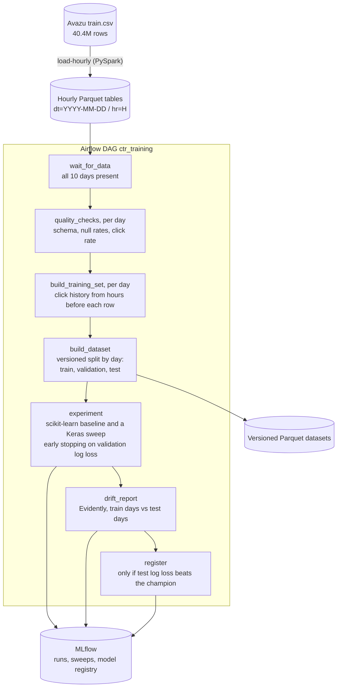
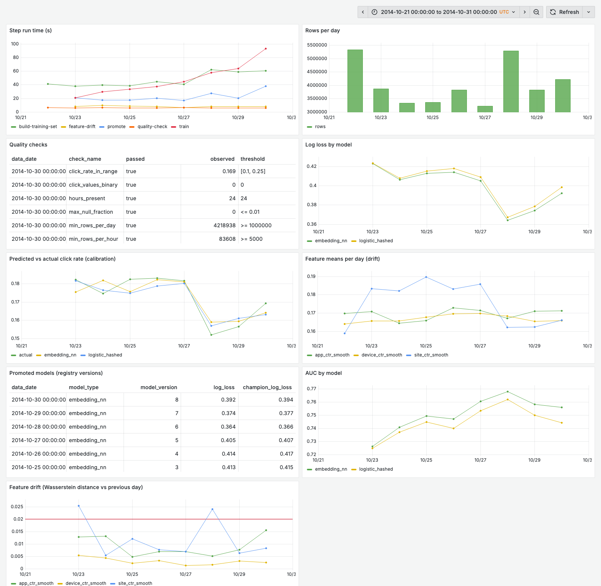

# Click-Through Rate (CTR) Prediction Pipeline

Turns 10 days of mobile ad logs into versioned training datasets split by day, trains a TensorFlow (Keras) click model against a scikit-learn logistic regression baseline, tunes it with tracked sweeps, and registers a new model only when its log loss beats the current one. A prototype that runs locally with Docker Compose.

- **Data:** [Avazu CTR](https://www.kaggle.com/competitions/avazu-ctr-prediction) `train.gz`, 40.4M ad impressions over 10 days (21 to 30 Oct 2014), each labelled clicked or not.
- **Stack:** Python, PySpark, TensorFlow (Keras), scikit-learn, Airflow, MLflow, Evidently, Docker, PyTest.
- **Models:** a Keras network with feature hashing and embeddings, and a scikit-learn logistic regression baseline, compared on AUC and log loss. Split by day: train 22 to 27 Oct, validation 28 Oct, test 29 and 30 Oct.

## How it works



Each Airflow task is one command (`python -m ctr_pipeline <step>`), so every step also runs by hand without Airflow. Airflow, MLflow and the training job run in Docker Compose.

## Results

From one replay of 22 to 30 Oct on a laptop (Apple M4, 16 GB). Day D is scored on all of its rows; each model is fitted on a 15% uniform sample of the days before D.

| Day D | Training rows | Rows scored | Logistic AUC | Logistic log loss | Embedding AUC | Embedding log loss | Promoted |
|---|---|---|---|---|---|---|---|
| 23 Oct | 800,569 | 3,870,752 | 0.7248 | 0.4234 | 0.7264 | 0.4231 | embedding, v1 |
| 24 Oct | 1,381,182 | 3,335,302 | 0.7373 | 0.4078 | 0.7409 | 0.4062 | embedding, v2 |
| 25 Oct | 1,881,477 | 3,363,122 | 0.7449 | 0.4151 | 0.7494 | 0.4127 | embedding, v3 |
| 26 Oct | 2,385,945 | 3,835,892 | 0.7401 | 0.4179 | 0.7472 | 0.4141 | embedding, v4 |
| 27 Oct | 2,961,329 | 3,225,010 | 0.7536 | 0.4089 | 0.7607 | 0.4049 | embedding, v5 |
| 28 Oct | 3,445,081 | 5,287,222 | 0.7621 | 0.3673 | 0.7681 | 0.3643 | embedding, v6 |
| 29 Oct | 4,238,164 | 3,832,608 | 0.7499 | 0.3787 | 0.7583 | 0.3743 | embedding, v7 |
| 30 Oct | 4,813,055 | 4,218,938 | 0.7445 | 0.3984 | 0.7560 | 0.3924 | embedding, v8 |

- **Promotion:** 23 Oct had no champion yet. On every later day the better candidate also beat the current champion's log loss on that day, so each day added one registry version.
- **Calibration:** on 30 Oct the embedding model's mean predicted click rate was 0.1642 against an actual 0.1693.
- **Run time:** one DAG run took 86 s on 22 Oct (no training yet) and grew to 279 s on 30 Oct as the training days add up.
- **Drift:** the distance passed the 0.02 alert line twice, both on the site feature: 0.0255 on 23 Oct and 0.0240 on 28 Oct.
- **Re-runs:** running all nine days a second time left the registry at the same 8 versions and the same champion. On 23 to 29 Oct the champion had been trained on that day, so it was kept without a comparison; on 30 Oct the retrained model matched it to the last digit of log loss.



`make alert-drill` writes one broken monitoring row per alert, waits for Grafana, then removes the rows. Measured run:

| Alert | Fired after | Back to normal after |
|---|---|---|
| Pipeline step took too long | 50 s | 120 s |
| Pipeline step failed | 40 s | 110 s |
| Training set row count too low | 40 s | 50 s |
| Input feature drift | 40 s | 110 s |
| Predicted click rate off from actual | 40 s | 50 s |

## Setup

Needs Docker, [uv](https://docs.astral.sh/uv/) and about 25 GB of free disk.

```bash
git clone https://github.com/DragonSonBlaze/ctr-training-pipeline.git && cd ctr-training-pipeline
make env      # creates .env; change the passwords in it
make sync     # Python 3.12 environment for the tests
```

Download `train.gz` from the competition's Data tab (needs a Kaggle account and accepting the rules), then:

```bash
mv ~/Downloads/train.gz data/raw/
make data                    # decompress to data/raw/train.csv
make up monitoring-init      # build and start Postgres, MLflow, Grafana and Airflow
make load                    # build the hourly Parquet tables
make pipeline                # trigger the Airflow DAG
```

| Service | URL |
|---|---|
| Airflow | http://localhost:8080 (no login; reachable from this machine only) |
| MLflow | http://localhost:5001 |
| Grafana | http://localhost:3000 (login from `.env`) |

Run the tests with `make test`. `make` alone lists every command.

## Status

Working: PySpark data preparation and quality checks, versioned datasets split by day, the scikit-learn baseline, the Keras model and its sweep in MLflow, registration only on lower test log loss, Evidently drift reports and calibration per run, the Airflow DAG in Docker Compose, and the PyTest suite.
Not yet: notifications from the Grafana alerts (they show in Grafana's Alerting page only).
