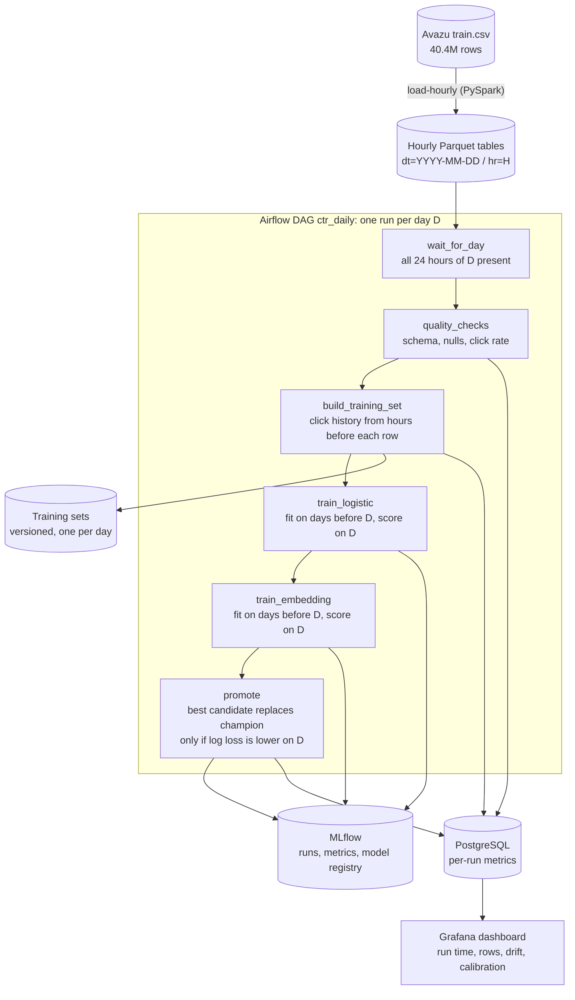

# CTR Training-Data and ML Pipeline

Turns 10 days of mobile ad logs into daily, leakage-free training sets, trains click-through-rate models on them, and promotes a new model only when it beats the current one. A prototype that runs end to end on a laptop.

- **Data:** [Avazu CTR](https://www.kaggle.com/competitions/avazu-ctr-prediction) `train.gz`, 40.4M ad impressions over 10 days (21 to 30 Oct 2014), each labelled clicked or not.
- **Stack:** Python 3.12, PySpark 4, Airflow 3, PyTorch, MLflow, PostgreSQL, Grafana, Docker Compose.
- **Models:** logistic regression and an embedding neural network on hashed categorical features, both retrained daily on earlier days and scored on the next day by AUC and log loss.

## How it works



Each Airflow task is one command (`python -m ctr_pipeline <step> --date D`), so every step also runs by hand without Airflow.

## Setup

Needs Docker, Java 17 or 21, [uv](https://docs.astral.sh/uv/) and about 15 GB of free disk.

```bash
git clone <this repo> && cd <repo folder>
make env      # creates .env; change the passwords in it
make sync     # Python 3.12 environment with all packages
```

Download `train.gz` from the competition's Data tab (needs a Kaggle account and accepting the rules), then:

```bash
mv ~/Downloads/train.gz data/raw/
make data                    # decompress to data/raw/train.csv
make up monitoring-init      # start Postgres, MLflow, Grafana; create metric tables
make load                    # build the hourly Parquet tables (about 3 minutes)
make airflow-install
make airflow                 # Airflow UI on localhost:8080; keep this terminal open
make replay                  # in a second terminal: runs the pipeline for every day
```

| Service | URL |
|---|---|
| Airflow | http://localhost:8080 (password in `.airflow/simple_auth_manager_passwords.json.generated`) |
| MLflow | http://localhost:5001 |
| Grafana | http://localhost:3000 (login from `.env`) |

Run the tests with `make test`. `make` alone lists every command.

## Status

Working: hourly tables, quality checks, training sets, both models, MLflow tracking and promotion, the Airflow DAG, the Grafana dashboard.
Not yet: Grafana alerts, a drift score beyond daily feature means.
